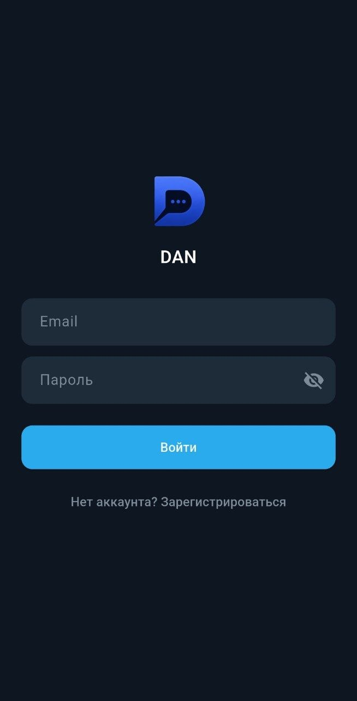
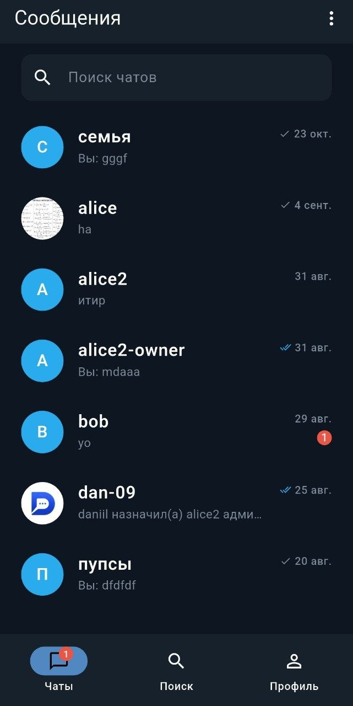
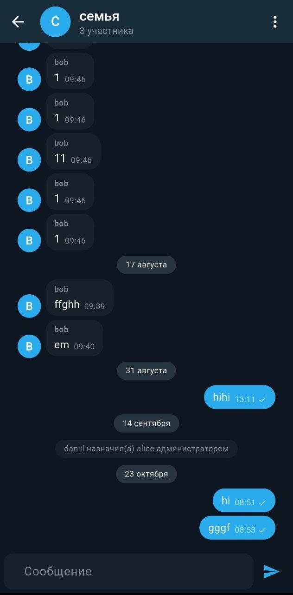
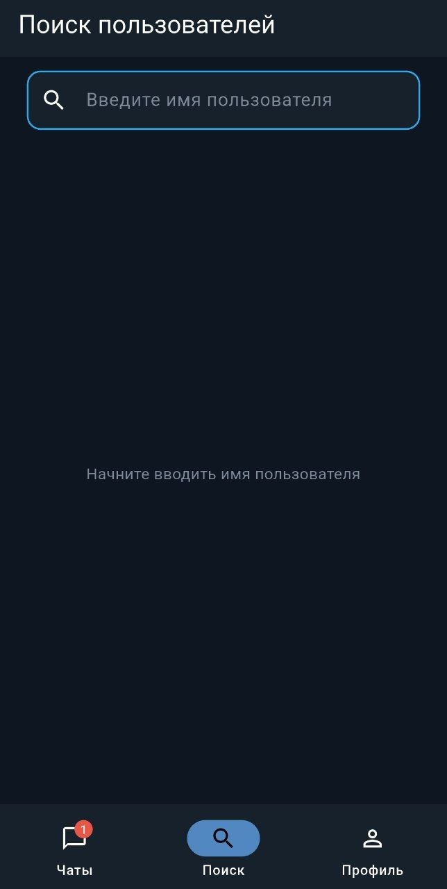
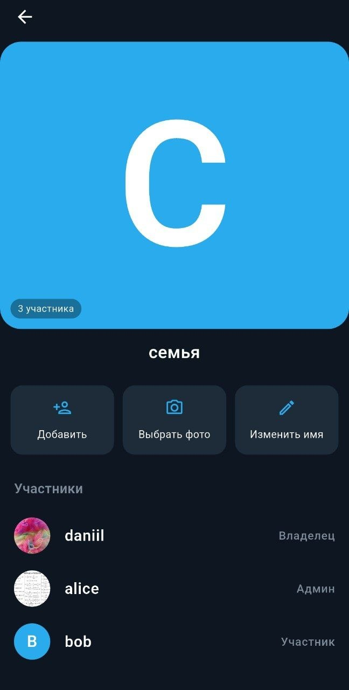

**[Читать на русском языке](README_ru.md)**

# DAN

A modern real-time messaging application for **Android**, **Web** and **Windows** 💬

## 📸 Screenshots

<table>
  <tr>
    <td align="center" width="25%">
       
      <b>Login</b>
    </td>
    <td align="center" width="25%">
       
      <b>Home</b>
    </td>
    <td align="center" width="25%">
       
      <b>Direct chat</b>
    </td>
    <td align="center" width="25%">
       
      <b>Group chat</b>
    </td>
  </tr>
</table>

<table>
  <tr>
    <td align="center" width="33%">
       
      <b>Search</b>
    </td>
    <td align="center" width="33%">
       
      <b>Profile</b>
    </td>
    <td align="center" width="33%">
       
      <b>Group management</b>
    </td>
  </tr>
</table>

## ✨ Features

- Real-time messaging
- Private (1-on-1) and group chats
- User/group profiles and user/chat searches
- User/group profile customization (names & avatars)
- Group management (creation, member management, admin roles)
- System messages (e.g. when users join or leave a group)
- Push notifications
- Real-time user statuses and typing indicators
- Responsive UI for mobile and desktop

## 🛠️ Tech Stack

### 📱 Frontend
- **Flutter/Dart**
- **BLoC (feature-first)** — state management
- **Clean Architecture** — project architecture
- **Dio** — HTTP client
- **Socket.IO Client** — real-time communication
- **go_router** — navigation
- **get_it** — dependency injection
- **Hive CE** — local storage and caching
- **flutter_secure_storage** — secure local storage
- **Firebase Cloud Messaging** — push notifications
- **flutter_local_notifications** — local notifications
- **image_picker** — image selection
- **cached_network_image** — network image caching
- **connectivity_plus** — network connectivity monitoring
- **freezed/json_serializable** — immutable models and JSON serialization
- **dartz** — functional error handling
- **bloc_concurrency / stream_transform** — event and stream processing

### 🖥️ Backend
- **Node.js/Express** — REST API
- **MongoDB/Mongoose** — database and ODM
- **Socket.IO** — real-time communication
- **JWT** — authentication
- **bcryptjs** — password hashing
- **Joi** — request validation
- **Firebase Admin SDK** — push notifications
- **Cloudinary** — image storage and management
- **Multer/Streamifier** — file upload handling
- **express-rate-limit** — API rate limiting
- **CORS/Cookie Parser** — request and cookie handling
- **dotenv** — environment configuration

## 🚀 Usage

### 📦 Download for Android
**Go to [Releases](https://github.com/daniilpaschenko/dan-chat/releases) and install apk-file**

## 🪟 Download for Windows
**Go to [Releases](https://github.com/daniilpaschenko/dan-chat/releases) and install exe-file**

## 🤖 Use the web version
Go to https://dan-chat.daniil-paschenko.workers.dev/