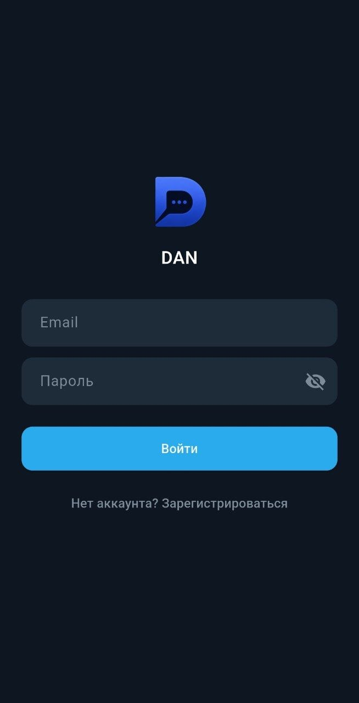
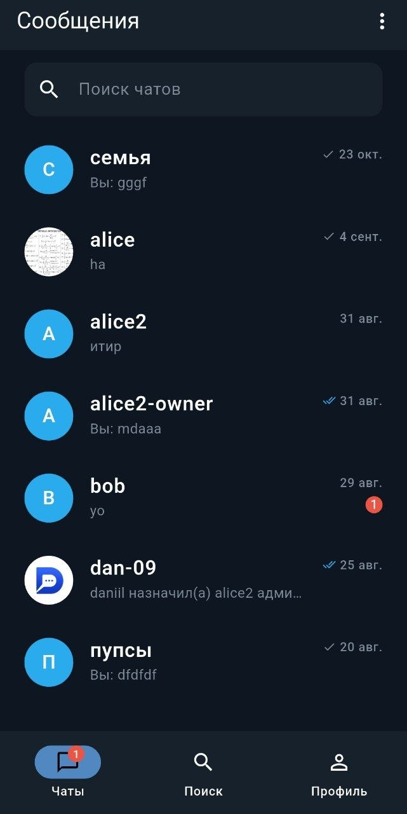
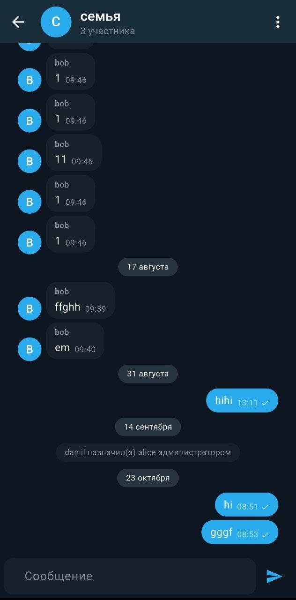
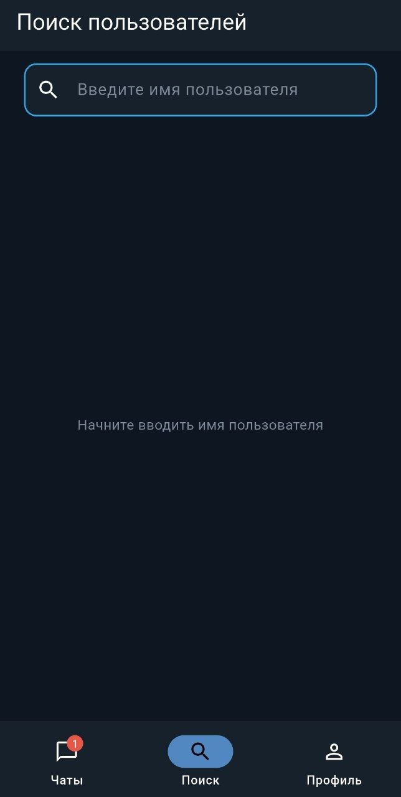
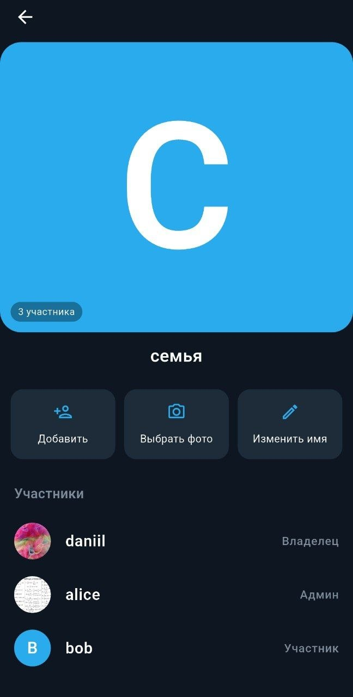

**[Read in English](README.md)**

# DAN

Современное приложение для обмена сообщениями в реальном времени для **Android**, **Web** и **Windows** 💬

## 📸 Скриншоты

<table>
  <tr>
    <td align="center" width="25%">
       
      <b>Логин</b>
    </td>
    <td align="center" width="25%">
       
      <b>Домашняя страница</b>
    </td>
    <td align="center" width="25%">
       
      <b>Директ</b>
    </td>
    <td align="center" width="25%">
       
      <b>Групповой чат</b>
    </td>
  </tr>
</table>

<table>
  <tr>
    <td align="center" width="33%">
       
      <b>Поиск</b>
    </td>
    <td align="center" width="33%">
       
      <b>Профиль</b>
    </td>
    <td align="center" width="33%">
       
      <b>Управление группой</b>
    </td>
  </tr>
</table>

## ✨ Возможности

- Обмен сообщениями в реальном времени
- Личные чаты (1-на-1) и групповые чаты
- Профили пользователей и групп, поиск пользователей и чатов
- Настройка профиля пользователя или группы (имена и аватары)
- Управление группами (создание, управление участниками, роли администраторов)
- Системные сообщения (например, при присоединении или выходе пользователей из группы)
- Push-уведомления
- Статусы пользователей и индикаторы набора сообщения в реальном времени
- Адаптивный интерфейс для мобильных устройств и компьютеров

## 🛠️ Технологический стек

### 📱 Frontend
- **Flutter/Dart**
- **BLoC (feature-first)** — управление состоянием
- **Clean Architecture** — архитектура проекта
- **Dio** — HTTP-клиент
- **Socket.IO Client** — обмен данными в реальном времени
- **go_router** — навигация
- **get_it** — внедрение зависимостей
- **Hive CE** — локальное хранение и кэширование
- **flutter_secure_storage** — безопасное локальное хранение
- **Firebase Cloud Messaging** — push-уведомления
- **flutter_local_notifications** — локальные уведомления
- **image_picker** — выбор изображений
- **cached_network_image** — кэширование изображений из сети
- **freezed/json_serializable** — неизменяемые модели и сериализация JSON
- **dartz** — функциональная обработка ошибок
- **bloc_concurrency / stream_transform** — обработка событий и потоков

### 🖥️ Backend
- **Node.js/Express** — REST API
- **MongoDB/Mongoose** — база данных и ODM
- **Socket.IO** — обмен данными в реальном времени
- **JWT** — аутентификация
- **bcryptjs** — хеширование паролей
- **Joi** — валидация запросов
- **Firebase Admin SDK** — push-уведомления
- **Cloudinary** — хранение и управление изображениями
- **Multer/Streamifier** — обработка загрузки файлов
- **express-rate-limit** — ограничение частоты запросов к API
- **CORS/Cookie Parser** — обработка запросов и cookies
- **dotenv** — конфигурация переменных окружения

## 🚀 Использование

### 📦 Скачать для Android
Перейдите в [Releases](https://github.com/daniilpaschenko/dan-chat/releases) и установите **apk-файл**

## 🪟 Скачать для Windows
Перейдите в [Releases](https://github.com/daniilpaschenko/dan-chat/releases) и установите **exe-файл**

## 🤖 Использовать веб-версию
Перейдите на сайт https://dan-chat.daniil-paschenko.workers.dev/